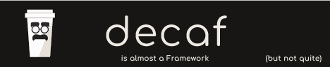

[](https://decaf-ts.github.io/for-os/)
## for-os

Native operating-system bridges for Decaf.ts: a Rust system tray and desktop
notification addon exposed to TypeScript, with runtime icon switching,
notification timers, and JavaScript button mapping.


[](https://github.com/decaf-ts/for-os/actions/workflows/jest-coverage.yaml)
[](https://github.com/decaf-ts/for-os/actions/workflows/codeql-analysis.yml)[](https://github.com/decaf-ts/for-os/actions/workflows/snyk-analysis.yaml)
[](https://github.com/decaf-ts/for-os/actions/workflows/release-on-merge-pr.yml)


Documentation [here](https://decaf-ts.github.io/for-os/), Test results [here](https://decaf-ts.github.io/for-os/workdocs/reports/html/test-report.html) and Coverage [here](https://decaf-ts.github.io/for-os/workdocs/reports/coverage/lcov-report/index.html)


### Description

`@decaf-ts/for-os` gives Node.js and TypeScript applications a small,
auditable bridge to the desktop:

- **System tray** — icon, tooltip, macOS title, and a menu whose entries call
  JavaScript handlers. The icon can be replaced at runtime from a file path,
  base64 string, byte buffer, or raw RGBA pixels.
- **Desktop notifications** — title/body, an auto-dismiss timer, and action
  buttons mapped to JavaScript callbacks. Button delivery is native on Linux
  (`notify-send --wait`); macOS and Windows render a plain notification.
- **Rust core** — the `native/tray-icon-node` crate is a vendored copy of
  [`nglmercer/tray-icon-node`](https://github.com/nglmercer/tray-icon-node) at
  commit `cb91e86184ed8612bcdee904277b4d5e78d966c3`, extended with the
  notification-action bridge, notification timers, and configurable buttons.
  It is built from the pinned source at install time; no prebuilt binary is
  downloaded.

The TypeScript layer never shells out to `notify-send` or PowerShell itself:
all OS commands live in the Rust crate, and every failure is reported through
the Decaf error hierarchy.


### How to Use

- [Native bridge reference](./workdocs/8-Native-Bridges.md)
- [Initial Setup](./workdocs/tutorials/For%20Developers.md#_initial_setup_)
- [Installation](./workdocs/tutorials/For%20Developers.md#installation)
- [Scripts](./workdocs/tutorials/For%20Developers.md#scripts)
- [Testing](./workdocs/tutorials/For%20Developers.md#testing)
- [Publishing](./workdocs/tutorials/For%20Developers.md#publishing)

Install the package and build the native addon:

```bash
npm install @decaf-ts/for-os
npm run for-os:init       # Rust toolchain + platform native build deps + addon
```

Use a tray whose icon changes at runtime and whose menu calls JavaScript:

```ts
import { TrayIcon, TRAY_ICON_BASE64 } from "@decaf-ts/for-os";

const tray = TrayIcon.create({
  icon: { base64: TRAY_ICON_BASE64.idle },
  tooltip: "My application",
  menu: [
    { id: "open", label: "Open" },
    { id: "pause", label: "Pause", checkable: true },
    { separator: true, id: "sep", label: "" },
    { id: "quit", label: "Quit" },
  ],
});

tray.on("open", () => (tray.setIcon({ base64: TRAY_ICON_BASE64.active }), openWindow()));
tray.on("pause", () => tray.toggleMenuItem("pause"));
tray.on("quit", () => tray.close());
```

Send a notification that auto-dismisses and maps a button to JavaScript:

```ts
import { NotificationCenter } from "@decaf-ts/for-os";

const notifications = new NotificationCenter();
notifications
  .registerAction("accept", () => acceptAppointment())
  .registerAction("see", () => openAppointment());

notifications.notify({
  title: "New appointment",
  body: "Accept or review the appointment?",
  timeoutMs: 8_000,
  buttons: [
    { id: "accept", label: "Accept" },
    { id: "see", label: "See" },
  ],
});
```


### Native Bridges

Everything in this section is exported from `@decaf-ts/for-os`.

#### Source provenance

| Concern | Location |
| --- | --- |
| System-tray Rust crate | `native/tray-icon-node` (vendored from `nglmercer/tray-icon-node` at `cb91e86184ed8612bcdee904277b4d5e78d966c3`, package `0.1.2`) |
| OS-notification native bridge | `native/tray-icon-node/src/lib.rs` — ported from `with-ai/vendor/tray-icon-node/src/lib.rs` (`show_notification`, `show_appointment_notification`, `poll_notification_actions`) |
| with-ai JS fallback notification helper | `with-ai/src/cli/appointments/notify.ts` — **not ported**; it duplicated `osascript`/`notify-send`/PowerShell calls outside Rust, which this package deliberately centralizes in the crate |
| Source pin | `native/tray-icon-node/source-manifest.json` (SHA-512 of every source file and the canonical tree digest) |
| Build output pin | `native/tray-icon-node/build-manifest.json` (target triple, cargo/rustc versions, built binary SHA-512) |
| Build scripts | `scripts/for-os-{init,build,install,integration,integrity}.mjs`, shared in `scripts/lib/native.mjs` |
| Rust tests | `cargo test --locked --manifest-path native/tray-icon-node/Cargo.toml` (`npm run for-os:test:rust`) |

#### System tray

```ts
import { TrayIcon } from "@decaf-ts/for-os";

const tray = TrayIcon.create({
  icon: "/path/to/icon.png",        // or { base64 }, { bytes }, { png }, { rgba, width, height }
  tooltip: "My application",
  title: "my-app",                  // macOS only
  menu: [
    { id: "open", label: "Open", onClick: () => openWindow() },
    { id: "sync", label: "Sync", enabled: false },
    { id: "auto", label: "Automatic", checkable: true, checked: true },
    { separator: true, id: "sep", label: "" },
    { id: "quit", label: "Quit" },
  ],
  onEvent: (event) => console.log(event.eventType, event.x, event.y),
});

tray.on("open", () => openWindow());
tray.setIcon({ base64: activePngBase64 });   // runtime icon switching
tray.setTooltip("Working…");
tray.updateMenuItem("sync", { enabled: true, label: "Sync now" });
tray.toggleMenuItem("auto");
tray.close();
```

- `TrayIcon.create` throws `NativeModuleUnavailableError` (missing addon) or
  `TrayError` (native failure). `TrayIcon.tryCreate` returns `undefined`
  instead.
- The native event pump runs every 100 ms (`pollIntervalMs`) and is unref'd.
  `tray.poll()` drains menu events synchronously, which is useful in tests.
- `close()` is idempotent and removes the temporary icon files.
- `TRAY_ICON_BASE64.idle` / `.active` are embedded 16×16 PNG examples for
  dynamic-icon smoke checks.

#### Notifications

```ts
import { NotificationCenter } from "@decaf-ts/for-os";

const center = new NotificationCenter();
center.registerAction("accept", () => acceptAppointment());

const notification = center.notify({
  title: "New appointment",
  body: "Accept or review the appointment?",
  timeoutMs: 8_000,                 // 0 disables the timer
  buttons: [
    { id: "accept", label: "Accept" },
    { id: "see", label: "See", onClick: () => openAppointment() },
  ],
  onDismiss: (reason) => console.log("dismissed", reason),
});

notification.onAction((id) => console.log("callback handled", id));
```

- `timeoutMs` is passed to the native notification service. Linux
  (`notify-send --expire-time`) and Windows (balloon-tip timeout) honour it;
  macOS applies its system dismissal policy. The bridge also tracks the timer
  locally so `onDismiss("timer")` always fires at the configured time.
- `dismiss()` marks the notification dismissed and reports `"manual"`. There is
  no portable API to close an already-visible OS notification, so this is
  bookkeeping, not a remote control.
- Action buttons are native on Linux. `notify-send --wait` blocks a Rust
  worker thread and the activated button id is queued to
  `pollNotificationActions()`. macOS and Windows show a plain notification;
  put equivalent actions in the tray menu there.
- The action id returned by the service is matched against global
  `registerAction` handlers, the notification's `onAction`, and each button's
  `onClick`, in that order. An id that matches no live notification only reaches
  global handlers; it never falls through to the most recent notification's
  callbacks. The reserved `default` body-click id maps to the first button of the
  notification that owns it.
- A notification is pruned from the centre's records when it is dismissed
  (`timeoutMs` timer or `dismiss()`), so its handlers no longer resolve.
- `notifyAppointment` uses the native Accept/See action set and normalizes the
  service's reserved `default` action to `see`.

#### Platform support

| Feature | Linux | macOS | Windows |
| --- | --- | --- | --- |
| Tray icon, tooltip, title, menu, events | yes | yes | yes |
| Runtime icon switching | yes | yes | yes |
| Notification title/body | yes (`notify-send`) | yes (`osascript`) | yes (PowerShell balloon) |
| Notification auto-dismiss timer | yes | system default | yes |
| Notification action buttons → JS | yes (`notify-send --wait`) | no | no |

#### Scripts

| Script | Purpose |
| --- | --- |
| `npm run for-os:init` | Install Rust stable + Linux native build libraries (or report the exact manual commands where installation is not permitted), then build and materialize the addon |
| `npm run for-os:init:check` | Report host readiness without mutating anything |
| `npm run for-os:build` | `cargo build --release --locked` from the pinned source and write `build-manifest.json` |
| `npm run for-os:build:check` | Verify the source pin and report the existing build |
| `npm run for-os:install` | Build (best effort) and materialize `node_modules/tray-icon-node` |
| `npm run for-os:install:required` | Same, but fail when the native build cannot run |
| `npm run for-os:integrity:record` | Re-pin the native source tree (security-relevant; review the diff) |
| `npm run for-os:integrity:check` | Verify the source tree against the pin |
| `npm run for-os:test:rust` | Rust unit tests (notification argument/timer/action contract and tray conversions) |
| `npm run for-os:integration` | Interactive real-tray check: runtime icon switch, notification button, menu actions |
| `npm run for-os:smoke` | Non-interactive tray create → icon switch → timed notification → close |
| `npm run for-os:buttons` | Sends an actionable notification and waits for a JavaScript button callback |

`postinstall` runs `scripts/for-os-install.mjs`, so a normal `npm install`
materializes the addon when a toolchain is present and degrades with a warning
when it is not. The addon is materialized under the package and, when npm
reports an `INIT_CWD`, under that project's `node_modules` as well; the loader
searches the current directory, `INIT_CWD`, and the Node entrypoint's directory,
and `FOR_OS_NATIVE_MODULE` can pin an explicit path.

To exercise button mapping on a headless Linux host, run the integration check
with a notification daemon and trigger the notification body (the default
action is aliased to the first caller button):

```bash
dbus-run-session -- xvfb-run -a bash -c '\
  dunst & sleep 2; (sleep 2; dunstctl action 0) & \
  npm run for-os:buttons'
```

#### CI / native smoke limitation

The real native smoke test (`tests/integration/native-smoke.test.ts`) is gated
on `FOR_OS_SMOKE=1` plus a live `DISPLAY` and notification daemon, so the
standard CI run skips it and only verifies the addon-unavailable path. The
TypeScript bridges are covered by the fake-native unit tests; CI integration of
the real tray/notification smoke is tracked as a follow-up after the current
release gate.

#### Prerequisites

- Node.js >= 20 and npm >= 10.
- Rust stable (`rustup`, `cargo`, `rustc`).
- Linux (Ubuntu/Debian): `build-essential pkg-config libgtk-3-dev
  libayatana-appindicator3-dev libglib2.0-dev libxdo-dev libx11-dev
  libnotify-bin`.
- macOS: Xcode command-line tools (`xcode-select --install`).
- Windows: Visual Studio Build Tools with **Desktop development with C++** and
  the MSVC Rust host toolchain.
- A graphical desktop session with a system-tray host and notification service
  for the real integration check. `--smoke` still needs a tray host and a
  notification daemon (for example `xvfb-run` plus `dunst`).

#### Security and integrity

- The addon is built from the audited source tree, never downloaded as a
  prebuilt `.node`.
- `source-manifest.json` pins every source/wrapper file by SHA-512 and the
  canonical source digest. Every build script verifies it before compiling.
- `build-manifest.json` records the source digest, target triple, toolchain
  versions, and binary SHA-512; a build is reused only when all still match.
- The crate performs no network access, no environment reads, and no dynamic
  code loading. `unsafe` is confined to the upstream Win32 message-loop pump
  and the documented tray-icon handle `Send`/`Sync` impls.
- Notification text is passed to host commands as argument vectors, never
  through a shell; AppleScript and PowerShell values are escaped in Rust.
  `notify-send` arguments end option parsing with `--` before the title and body,
  so leading-dash text is delivered literally.
- Caller-supplied icon extensions are sanitized to an alphanumeric/dot suffix
  (capped at 16 characters) before the icon is materialized, and the resolved
  path is checked to stay inside the private icon directory.

#### Published package layout

- `files` publishes three things: the compiled output `lib` (ESM at
  `lib/esm`, CommonJS at `lib/cjs`, declarations at `lib/types`), the
  `native/tray-icon-node` Rust sources (Cargo manifest and lockfile plus the
  NAPI-RS loader `index.js`/`index.d.ts`, with `target/`, any built `.node`,
  and `build-manifest.json` excluded), and the `scripts/` folder that
  `postinstall` runs. Consumers build the addon locally at install time;
  no prebuilt binary is ever published.
- `exports` maps `.` to both module systems: ESM at `./lib/esm/index.js`
  with types `./lib/types/index.d.mts`, and CommonJS at `./lib/cjs/index.cjs`
  with types `./lib/types/index.d.cts`. `main`, `module`, and `types` mirror
  the same entry points.

#### Publishing and credential gates

- Publishing follows the repository's standard release path (`release`,
  `prepare-release`, tag/release workflows). It requires the existing npm
  publish credential (`NPM_TOKEN` in `.npmrc`); no new credential is
  introduced by this package.
- Building the native addon requires access to the Rust toolchain and the
  crates.io registry at install/build time; `Cargo.lock` pins the full crate
  closure.
- CI runners that publish must have the platform native libraries listed
  above. A runner without them can still publish the TypeScript output, but
  `npm run for-os:install:required` will fail by design.


### Related

- [`@decaf-ts/core`](https://github.com/decaf-ts/core) — persistence, services, and adapters.
- [`@decaf-ts/logging`](https://github.com/decaf-ts/logging) — the Decaf logger and error hierarchy.
- [`@decaf-ts/db-decorators`](https://github.com/decaf-ts/db-decorators) — the concrete Decaf error classes used by this package.
- [`nglmercer/tray-icon-node`](https://github.com/nglmercer/tray-icon-node) — upstream source of the vendored Rust tray crate.


### Social

[](https://www.linkedin.com/in/TiagoVenceslau/)


#### Languages


## Getting help

If you have bug reports, questions or suggestions, please [create a new issue](https://github.com/decaf-ts/for-os/issues/new/choose).

## Contributing

I am grateful for any contributions made to this project. Please read [this](./workdocs/tutorials/Contributing.md) to get started.

## Supporting

The first and easiest way you can support it is by [Contributing](./workdocs/tutorials/Contributing.md). Even just finding a typo in the documentation is important.

Financial support is always welcome and helps keep both me and the project alive and healthy.

So if you can, if this project in any way. either by learning something or simply by helping you save precious time, please consider donating.

## License

This project is released under the [MIT License](./LICENSE.md).

By developers, for developers...

